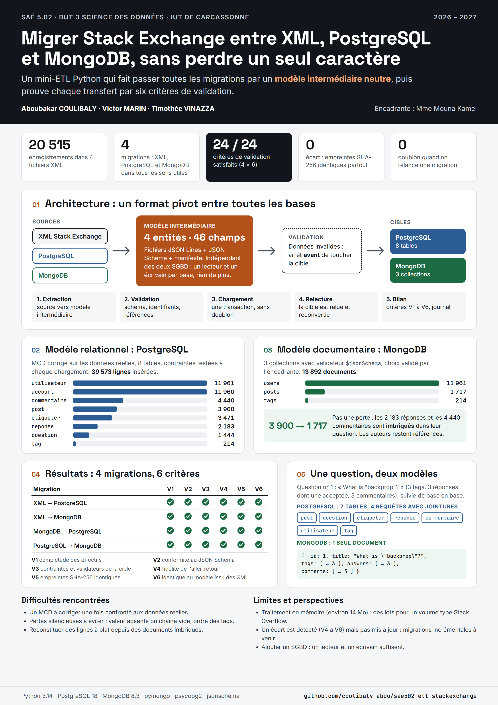

# SAÉ 5.02 : mini-ETL Stack Exchange entre XML, PostgreSQL et MongoDB

BUT 3 Science des Données, IUT de Carcassonne. Encadrante : Mme Mouna Kamel.
Groupe : Aboubakar COULIBALY, Victor MARIN, Timothée VINAZZA.

L'outil migre les données Stack Exchange (4 fichiers XML) vers PostgreSQL (modèle relationnel)
et vers MongoDB (modèle documentaire), puis entre les deux SGBD. Toutes les migrations passent par un
**modèle intermédiaire** (fichiers JSON Lines), indépendant de PostgreSQL et de MongoDB.

```
XML ─────────┐                                         ┌──► PostgreSQL  (8 tables)
PostgreSQL ──┼──► modèle intermédiaire ──► validation ──┤
MongoDB ─────┘    intermediaire/<source>/               └──► MongoDB     (3 collections)
```

Chaque migration est suivie d'une validation par six critères (V1 à V6, voir plus bas).

**Résultat : 4 migrations validées, 24 critères sur 24, empreintes SHA-256 identiques partout.**
Poster : [`docs/poster/poster_sae502.pdf`](docs/poster/poster_sae502.pdf) · Rapport final : [`docs/rapport/Rapport_SAE502_final_complet.pdf`](docs/rapport/Rapport_SAE502_final_complet.pdf)



---

## 1. Prérequis

| Élément | Version testée | Remarque |
|---|---|---|
| Python | 3.14 (3.10 minimum) | |
| PostgreSQL | 18 | serveur sur `localhost:5434` |
| MongoDB | 8.3 | serveur sur `localhost:27017`, sans authentification |
| mongosh | 2.9 | seulement pour `verification_mongodb.js` |
| Bibliothèques Python | voir `requirements.txt` | pymongo, psycopg2-binary, jsonschema |

Installation des bibliothèques :

```powershell
pip install -r requirements.txt
```

Les fichiers sources `Users.xml`, `Posts.xml`, `Comments.xml` et `Tags.xml` doivent se trouver dans
ce dossier. Ils sont seulement lus, jamais modifiés.

---

## 2. Configuration

**PostgreSQL** : hôte `localhost`, port `5434`, utilisateur `postgres` (dictionnaire `CONNEXION`
de `postgres_etl.py`). Le mot de passe n'est écrit dans **aucun fichier** : il est lu dans la variable
d'environnement `STACKEXCHANGE_DB_PASSWORD`.

```powershell
# PowerShell, pour le terminal en cours
$env:STACKEXCHANGE_DB_PASSWORD = "votre_mot_de_passe"

# ou une fois pour toutes (pris en compte dans les nouveaux terminaux)
setx STACKEXCHANGE_DB_PASSWORD "votre_mot_de_passe"
```

Dans l'invite de commandes Windows (cmd), la syntaxe est `set STACKEXCHANGE_DB_PASSWORD=votre_mot_de_passe`.

**MongoDB** : `mongodb://localhost:27017` (constante `URI_MONGO` de `import_3_collections.py`).

**Bases utilisées par défaut** (modifiables avec `--base-pg` et `--base-mongo`) :

| Migration | Base source | Base cible |
|---|---|---|
| `xml postgresql` | fichiers XML | PostgreSQL `Stackexchange` |
| `xml mongodb` | fichiers XML | MongoDB `stack_exchange_3col` |
| `mongodb postgresql` | MongoDB `stack_exchange_3col` | PostgreSQL `stackexchange_depuis_mongodb` |
| `postgresql mongodb` | PostgreSQL `Stackexchange` | MongoDB `stack_exchange_depuis_postgresql` |

Une base cible absente est créée automatiquement. Aucune base, table ou collection n'est jamais vidée
ni supprimée, et un enregistrement déjà présent n'est jamais remplacé : on peut relancer une migration
sans créer de doublon.

---

## 3. Programmes

| Fichier | Rôle |
|---|---|
| **`etl.py`** | **commande principale** : les quatre migrations et la validation d'un modèle intermédiaire |
| `intermediaire.py` | définition du modèle intermédiaire (4 entités, 46 champs), JSON Schema, écriture, lecture, validation |
| `xml_vers_intermediaire.py` | lecteur XML → modèle intermédiaire, avec reconstitution de chaque ligne XML |
| `postgres_etl.py` | écrivain modèle intermédiaire → PostgreSQL et lecteur PostgreSQL → modèle intermédiaire |
| `schema.sql` | création des 8 tables PostgreSQL et de leurs contraintes |
| `modele_3_collections.py` | modèle MongoDB en 3 collections (users, posts, tags) : construction, opération inverse, validateurs, index |
| `import_3_collections.py` | écrivain modèle intermédiaire → MongoDB et lecteur MongoDB → modèle intermédiaire |
| `verification.sql` | 10 requêtes de contrôle d'une base PostgreSQL (lecture seule) |
| `verification_mongodb.js` | comparaison document par document de deux bases MongoDB (lecture seule) |

---

## 4. Commandes disponibles

```powershell
python etl.py xml postgresql          # XML -> PostgreSQL
python etl.py xml mongodb             # XML -> MongoDB
python etl.py mongodb postgresql      # MongoDB -> PostgreSQL
python etl.py postgresql mongodb      # PostgreSQL -> MongoDB
python etl.py valider DOSSIER_IR      # valide un modèle intermédiaire existant
```

| Option | Rôle | Valeur par défaut |
|---|---|---|
| `--base-pg NOM` | base PostgreSQL (source ou cible) | voir le tableau des bases |
| `--base-mongo NOM` | base MongoDB (source ou cible) | voir le tableau des bases |
| `--dossier-xml D` | dossier des fichiers XML | dossier du projet |
| `--ir D` | dossier où écrire le modèle intermédiaire | `intermediaire/<source>` |
| `--reference D` | modèle intermédiaire de référence pour V6 | `intermediaire/xml` |

Chaque migration se déroule en cinq étapes :

1. **Extraction** : le lecteur de la source écrit le modèle intermédiaire dans `intermediaire/<source>/` ;
2. **Validation** du modèle intermédiaire ; s'il n'est pas valide, tout s'arrête avant de toucher la cible ;
3. **Chargement** dans la cible, avec les contrôles propres à la cible ;
4. **Relecture** de la cible et reconversion en modèle intermédiaire ;
5. **Bilan** selon les six critères ci-dessous.

Le code de sortie vaut 0 si la migration est validée, 1 sinon. Tout ce qui est affiché est aussi
ajouté au fichier `journal_etl.txt`.

### Critères de validation

| Critère | Ce qui est vérifié |
|---|---|
| **V1 Complétude** | même nombre d'enregistrements par entité dans le modèle extrait et dans la cible relue |
| **V2 Conformité** | le modèle intermédiaire extrait est valide : manifeste, JSON Schema, identifiants uniques, 0 référence orpheline |
| **V3 Contrôles de la cible** | effectifs par table ou collection, comparaison ligne par ligne ou document par document, contraintes PostgreSQL ou validateur MongoDB qui refusent des données invalides, aucun rejet |
| **V4 Fidélité** | le modèle relu depuis la cible est identique, champ par champ, au modèle extrait |
| **V5 Empreintes** | les empreintes SHA-256 des 4 entités sont identiques avant et après migration |
| **V6 Bout en bout** | le modèle relu depuis la cible est identique au modèle de référence produit depuis les XML |

La migration est **validée** si les six critères sont satisfaits.

### Vérifications manuelles complémentaires

```powershell
# PostgreSQL : 10 contrôles (effectifs, types, références, valeurs nulles, compteurs)
$env:PGPASSWORD = "votre_mot_de_passe"
& "C:\Program Files\PostgreSQL\18\bin\psql.exe" -h localhost -p 5434 -U postgres -d stackexchange_depuis_mongodb -f verification.sql

# MongoDB : stack_exchange_depuis_postgresql comparée document par document à stack_exchange_3col
mongosh --quiet verification_mongodb.js
```

---

## 5. Exemples d'exécution

### Migration MongoDB → PostgreSQL (vers une base neuve)

```
> python etl.py mongodb postgresql
=== Migration mongodb -> postgresql (04/11/2026 15:26:28) ===
Source : mongodb (base stack_exchange_3col)
Cible  : postgresql (base stackexchange_depuis_mongodb)

--- 1. Extraction : source -> modèle intermédiaire ---
Effectifs extraits : users 11961, posts 3900, comments 4440, tags 214

--- 2. Validation du modèle intermédiaire ---
  [OK   ] users     11961 lignes conformes
  ...
  [OK   ] posts.accepted_answer_id -> réponse de cette question

--- 3. Chargement : modèle intermédiaire -> postgresql ---
Base stackexchange_depuis_mongodb créée (elle n'existait pas).
Insertion (une seule transaction) :
  utilisateur  lignes à insérer= 11961  insérées= 11961  déjà présentes=     0
  post         lignes à insérer=  3900  insérées=  3900  déjà présentes=     0
  commentaire  lignes à insérer=  4440  insérées=  4440  déjà présentes=     0
  ...
Contraintes (chaque tentative doit être refusée, puis annulée) :
  OK     commentaire avec identifiant ET nom d'auteur : refusé
  OK     réponse acceptée qui n'appartient pas à la question : refusé
  OK     tag en position 6 : refusé
  OK     deuxième extrait pour le même tag : refusé

--- 5. Bilan de la migration mongodb -> postgresql ---
  [OK   ] V1 Complétude                users 11961/11961, posts 3900/3900, comments 4440/4440, tags 214/214
  [OK   ] V2 Conformité de l'IR        manifeste, JSON Schema, identifiants, références
  [OK   ] V3 Contrôles de la cible     écrivain postgresql
  [OK   ] V4 Fidélité (aller-retour)   IR relue = IR extraite, champ par champ
  [OK   ] V5 Empreintes SHA-256        users e33bd3ade8a5…, posts 946e12dc871e…, comments 8f8df10e04e4…, tags beb96f1b6026…
  [OK   ] V6 Bout en bout              IR relue = IR de référence (intermediaire\xml)

MIGRATION MONGODB -> POSTGRESQL VALIDÉE.
```

### Migration PostgreSQL → MongoDB

```
> python etl.py postgresql mongodb
Base stack_exchange_depuis_postgresql :
  users  créée avec son validateur $jsonSchema
  posts  créée avec son validateur $jsonSchema
  tags   créée avec son validateur $jsonSchema
Insertion :
  users  insérés= 11961  déjà présents=     0  rejetés=0
  posts  insérés=  1717  déjà présents=     0  rejetés=0
  tags   insérés=   214  déjà présents=     0  rejetés=0
Test du validateur : OK (document invalide refusé)
...
MIGRATION POSTGRESQL -> MONGODB VALIDÉE.
```

Les 3 900 posts deviennent 1 717 documents : les 2 183 réponses et les 4 440 commentaires sont
imbriqués dans leur question.

### Relance d'une migration déjà faite (aucun doublon)

```
> python etl.py xml postgresql
  utilisateur  lignes à insérer= 11961  insérées=     0  déjà présentes= 11961
  post         lignes à insérer=  3900  insérées=     0  déjà présentes=  3900
  ...
MIGRATION XML -> POSTGRESQL VALIDÉE.
```

### Vérification MongoDB

```
> mongosh --quiet verification_mongodb.js
users  origine=11961  migree=11961  absents=0  differents=0  en trop=0  OK
posts  origine=1717  migree=1717  absents=0  differents=0  en trop=0  OK
tags   origine=214  migree=214  absents=0  differents=0  en trop=0  OK
posts ne respectant pas le validateur : 0  OK

MIGRATION POSTGRESQL -> MONGODB : AUCUNE ERREUR
```

### Erreurs prévues

```
> python etl.py mongodb xml
etl.py: error: migrations possibles : xml postgresql, xml mongodb, mongodb postgresql, postgresql mongodb (ou : valider DOSSIER_IR)

> python etl.py postgresql mongodb        (sans mot de passe)
La variable STACKEXCHANGE_DB_PASSWORD n'est pas définie : rien n'a été lu ni modifié.
```

---

## 6. Résultats obtenus (04/11/2026)

| Migration | V1 à V6 | Détail |
|---|---|---|
| XML → MongoDB | 6/6 | 11 961 users, 1 717 posts, 214 tags ; relance sans doublon |
| XML → PostgreSQL | 6/6 | 8 tables : 11 961 utilisateurs, 3 900 posts, 4 440 commentaires, 214 tags, 3 471 étiquetages ; relance sans doublon |
| MongoDB → PostgreSQL | 6/6 | base neuve ; `verification.sql` : tous les contrôles conformes |
| PostgreSQL → MongoDB | 6/6 | base neuve ; `verification_mongodb.js` : 0 document absent ou différent |

Dans les quatre migrations, les empreintes SHA-256 des données relues dans la cible sont identiques
à celles du modèle intermédiaire produit depuis les XML : aucune valeur n'a été perdue ni modifiée.

---

## 7. Arborescence

```
etl.py, *.py              programmes
schema.sql                tables PostgreSQL
verification.sql          contrôles PostgreSQL
verification_mongodb.js   contrôles MongoDB
Users.xml, Posts.xml, Comments.xml, Tags.xml   données sources
intermediaire/xml/        modèle intermédiaire de référence (produit depuis les XML)
intermediaire/postgresql/ modèle intermédiaire extrait de PostgreSQL
intermediaire/mongodb/    modèle intermédiaire extrait de MongoDB
schemas/                  JSON Schema des 4 entités du modèle intermédiaire
modele_documentaire_3_collections/   format et exemples du modèle MongoDB
journal_etl.txt           journal des migrations (créé à l'exécution)
journaux/                 journaux d'exécution conservés (dont journal_etl.txt du 04/11/2026)
docs/rapport/             rapports : Livrable 1, Livrable 2, rapport final complet (docx et pdf)
docs/captures/            captures des exécutions réelles (migrations, vérifications)
docs/modelisation/        MCD, MLD, modèle intermédiaire, modèle MongoDB
docs/poster/              poster de présentation des résultats (A3, pdf et png)
docs/sujet/               sujet de la SAÉ
```

---

## 8. Limites connues

- Les dates des XML n'ont pas de fuseau horaire : elles sont considérées en UTC.
- Les données sont traitées en mémoire : adapté à ce jeu (environ 14 Mo), pas à un dump complet de Stack Overflow.
- Les paramètres de connexion (hôte, port, utilisateur) sont fixés dans le code ; seul le mot de passe passe par une variable d'environnement.
- Une migration ajoute les enregistrements absents mais ne met pas à jour ceux qui existent déjà avec un contenu différent : dans ce cas, V4 à V6 signalent l'écart.
